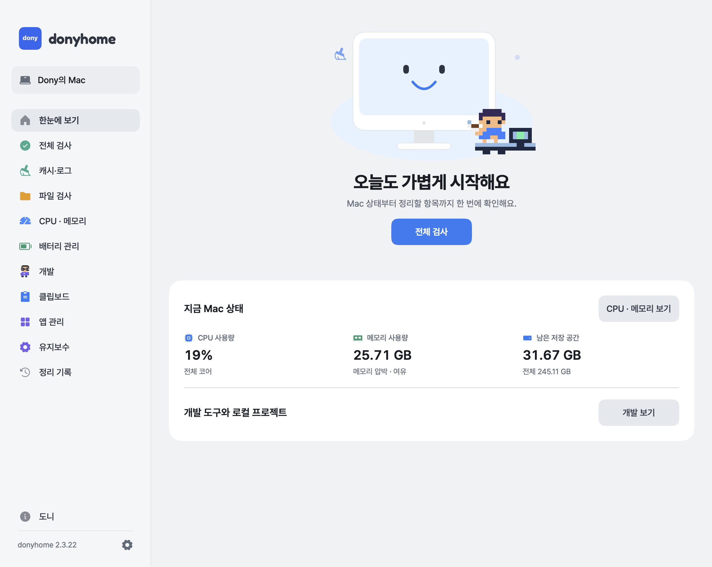
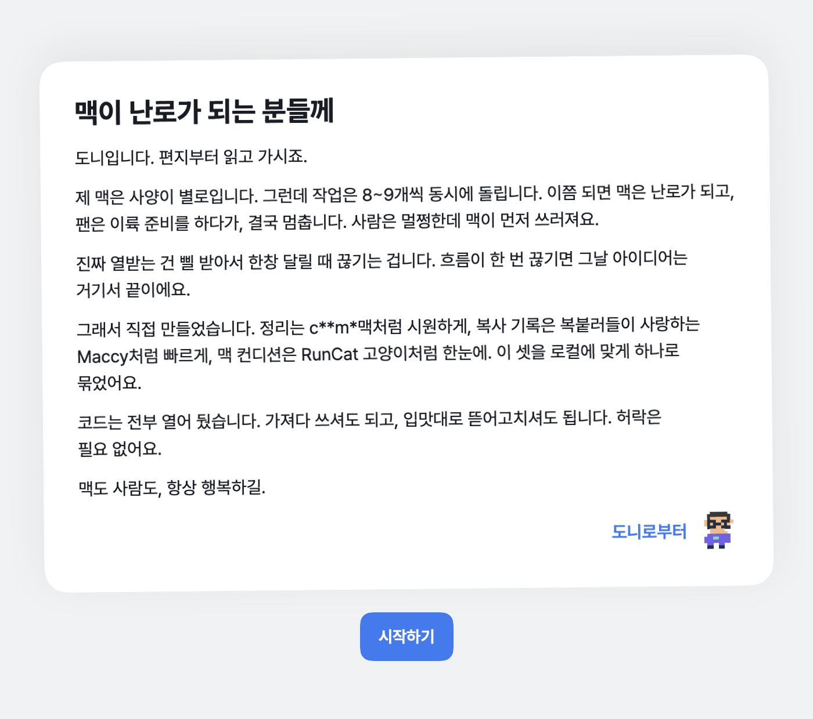
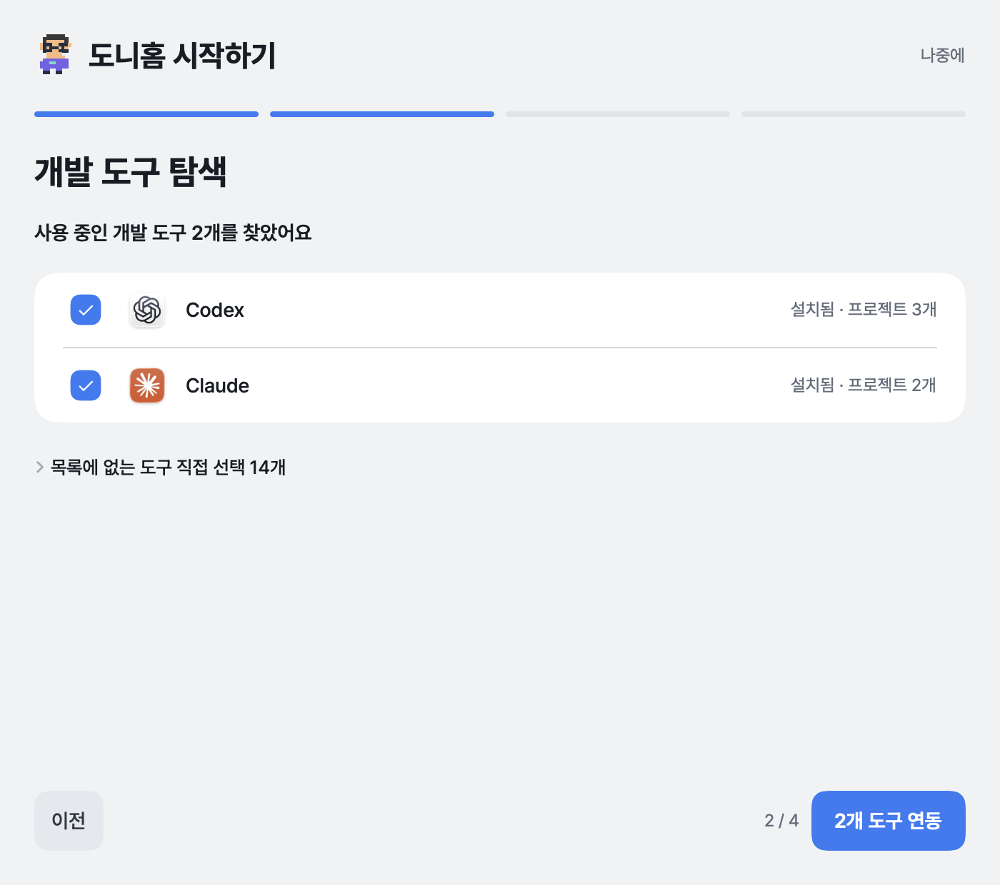
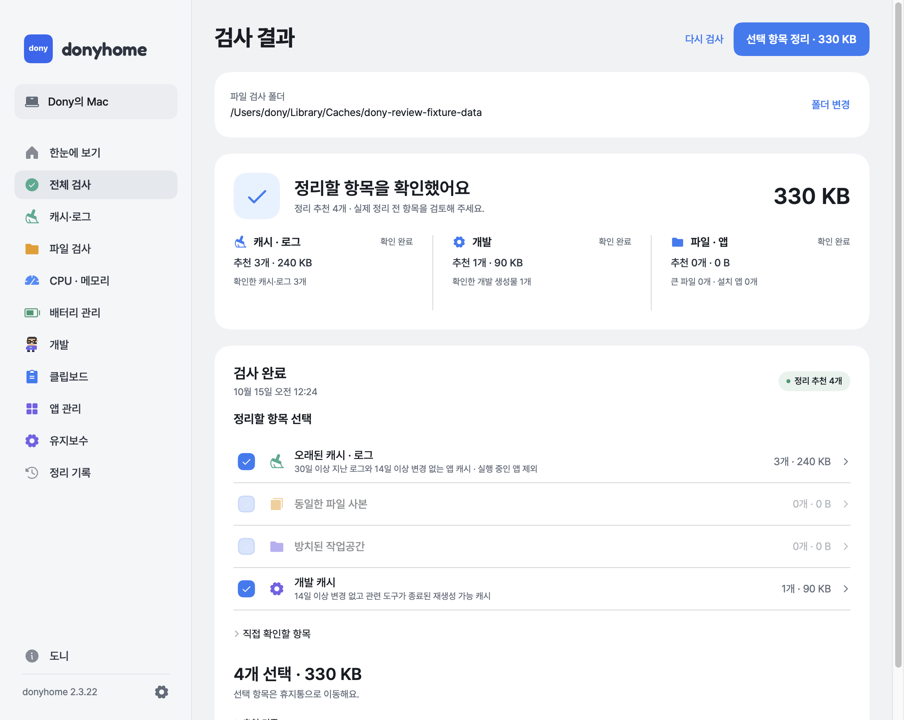
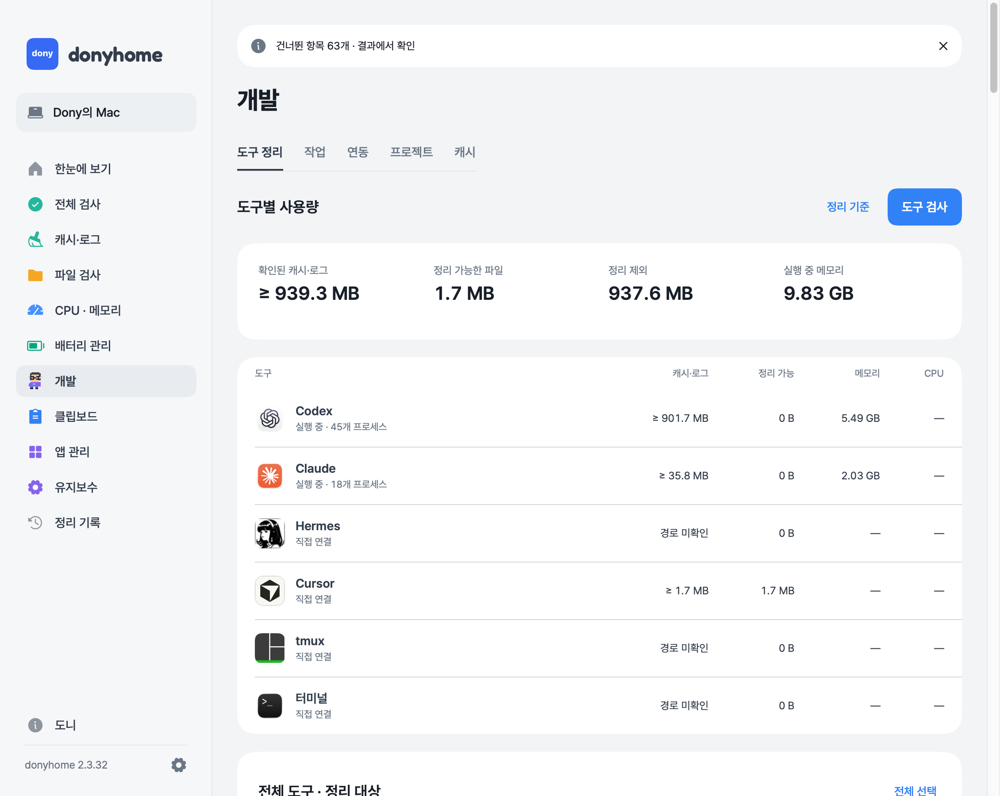
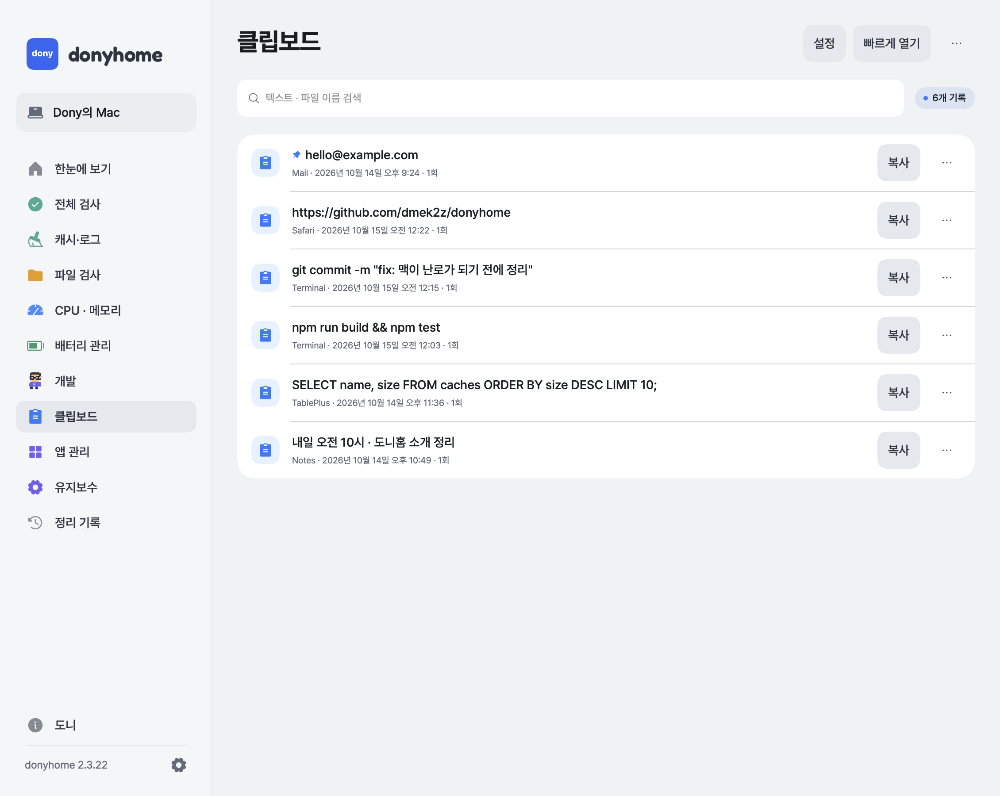
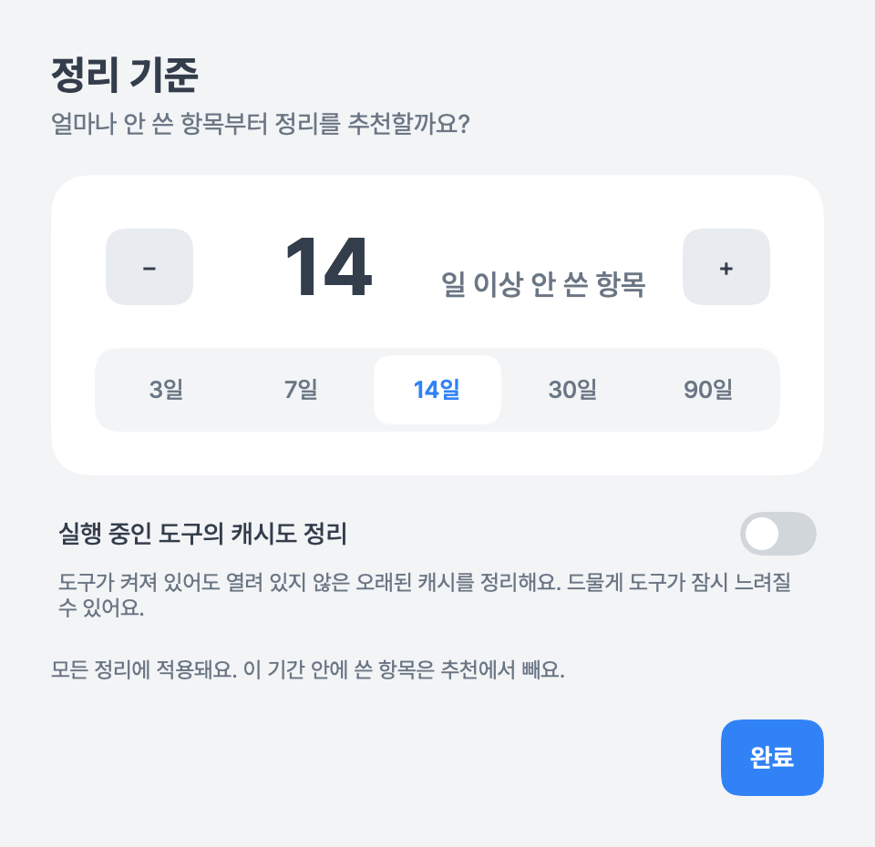

# donyhome · 도니홈

**맥이 난로가 되기 전에.**
Mac 정리, 개발 도구 케어, 클립보드를 한 앱에 담은 macOS 앱입니다. 서버도, 계정도, 외부 전송도 없이 내 Mac 안에서만 돌아갑니다.

<p align="center"></p>

## 왜 만들었나

사양이 넉넉하지 않은 맥으로 작업을 8~9개씩 동시에 돌리면 맥은 난로가 되고, 팬은 이륙 준비를 하다가 결국 멈춥니다. 한창 삘 받아서 달리는 중에 흐름이 끊기는 게 제일 싫어서 로컬에 딱 맞게 직접 만들었습니다.
정리는 CleanMyMac처럼 시원하게, 복사 기록은 [Maccy](https://github.com/p0deje/Maccy)처럼 빠르게, 맥 컨디션은 [RunCat](https://kyome.io/runcat/index.html) 고양이처럼 한눈에. 이 셋을 하나로 묶은 앱입니다. 전부 열어 뒀으니 가져다 쓰셔도, 입맛대로 뜯어고치셔도 됩니다.

앱 안의 **도니 → 도니의 편지**에서 같은 이야기를 편지로 읽을 수 있습니다.

## 화면

| 첫 실행: 도니의 편지 | 첫 실행: 도구 연동 |
|---|---|
|  |  |
| **전체 검사 결과** | **개발 · 도구 정리** |
|  |  |
| **클립보드** | **정리 기준** |
|  |  |

## 기능

### 한눈에 보기
- CPU, 메모리와 메모리 압박, 스왑, 남은 저장 공간을 실시간으로 보여줍니다.
- 가운데 **전체 검사** 버튼 하나로 정리 흐름을 시작합니다.

### 전체 검사
검사 → 정리 추천 → 검토 → 선택 항목 정리(휴지통) 순서입니다.
- **한 번에 검사하는 것:** 캐시·로그, 개발 캐시, 동일한 파일 사본, 방치된 작업공간, 큰 파일, 오래된 파일·설치 파일, 유사 사진, 남은 앱 파일, 폴더 용량, 휴지통, 설치 앱.
- 추천 항목은 미리 체크되고, 행을 누르면 추천 사유와 함께 해당 목록이 열립니다.
- 정리하기 직전에 파일 상태를 다시 확인하고, 바뀐 파일은 건드리지 않습니다. 정리한 항목은 휴지통으로 이동하며, 정리 기록에 남습니다.

### 캐시·로그
`~/Library/Caches`, `~/Library/Logs`의 항목을 개별 파일로 추천하고 앱·경로별 발견·추천·유지 용량을 보여줍니다. 실행 중인 앱의 캐시는 제외합니다.

### 파일 검사
- **큰 파일:** 선택한 폴더의 100 MB 이상 파일.
- **중복 파일:** 크기 → SHA-256 → 실제 바이트 비교. 그룹마다 원본 한 개는 남깁니다.
- **오래된 파일 · 설치 파일:** 180일 이상 안 쓴 파일, dmg/pkg/iso.
- **유사 사진:** macOS Vision으로 로컬에서 비교하고 남길 사진을 고릅니다.
- **폴더 용량:** 크기순 폴더 지도로 어디가 큰지 탐색합니다.

### CPU · 메모리
- 앱과 도우미 프로세스를 합산한 CPU·메모리 사용량을 보여줍니다.
- CPU가 높거나 메모리를 많이 쓰는 앱을 추려서 선택해 종료를 요청할 수 있습니다. 시스템 앱과 도니홈 자체는 보호합니다.

### 배터리 관리 (MacBook)
[battery](https://github.com/actuallymentor/battery) 엔진을 통합했습니다. 충전 상한·범위·전압 유지, 강제 방전, 충전·어댑터 제어, 보정을 지원합니다. 설치는 macOS 관리자 인증을 거치며 권한은 고정된 SMC 쓰기 명령으로만 제한합니다. 내장 배터리가 없는 Mac에서는 비활성입니다.

### 개발
Codex, Claude, Hermes, Orca, Cursor, Herdr, cmux, tmux, 터미널, OpenCode, Gemini, Aider, Copilot, VS Code, Windsurf를 도구 아이콘과 함께 연동합니다.
- **도구 정리:** 도구별 캐시·로그·정리 가능 용량과 실행 중인 프로세스의 CPU·메모리를 한 표에서 봅니다.
- **작업:** 실행 중인 CLI 작업을 확인하고 일시 정지·재개·종료합니다.
- **연동:** 어떤 도구를 연결할지 고릅니다.
- **프로젝트:** 연동한 도구의 작업 이력에서 프로젝트를 자동으로 가져오고 빌드·캐시 정리 후보를 확인합니다.
- **캐시:** Xcode·npm·pip·Homebrew·Yarn·pnpm 캐시. 실행 중인 도구와 최근 변경을 확인한 뒤 추천합니다.
- **정리 기준:** 「N일 이상 안 쓴 항목」을 정리 후보로 추천합니다(기본 14일). 캐시·로그·개발 캐시·프로젝트에 공통 적용됩니다.

### 클립보드
Maccy의 캡처·검색 로직을 통합했습니다.
- 텍스트·서식·이미지·파일 기록, 로컬 OCR 검색, 퍼지 검색, 고정, 기록 편집.
- **빠르게 열기**: 전역 단축키(기본 ⇧⌘C, 설정에서 변경)로 창을 열고 Enter로 복사, Option-Enter로 붙여넣기.
- 붙여넣기에는 손쉬운 사용 권한이, 복사 기록 저장에는 「다른 앱에서 붙여넣기」 허용이 필요합니다. 막혀 있으면 설정 화면에서 안내합니다.

### 앱 관리 · 유지보수 · 정리 기록
- **앱 관리:** 설치한 앱과 앱 ID가 정확히 일치하는 캐시·설정·컨테이너, 연결된 앱이 없는 남은 파일.
- **유지보수:** 휴지통 비우기, DNS 초기화, Spotlight 재색인, Time Machine 로컬 스냅샷 목록과 선택 제거. 모두 확인 후 실행합니다.
- **정리 기록:** 최근 500건의 결과와 실패 이유.

### 메뉴 막대와 알림
- 메뉴 막대의 픽셀 캐릭터가 Mac 상태에 따라 움직입니다. **여유**(커피 한 잔)일 땐 느긋하게, **과부하**(땀 뻘뻘)일 땐 정신없이 타이핑합니다.
- CPU·메모리 과부하와 저장 공간 부족을 알림으로 알려줍니다.
- 설정에서 **Dock에 아이콘 숨기기**를 켜면 Dock과 Cmd-Tab에서 사라지고 메뉴 막대에서만 실행됩니다(기본은 꺼짐).

### 첫 실행
도니의 편지 → 기능 소개 → Mac 권한 → 개발 도구 탐색·연동 → 프로젝트 자동 동기화·정리 기준. 설정에서 다시 열 수 있습니다.

## 안전 원칙
- 파일은 삭제하지 않고 휴지통으로 이동합니다(휴지통 비우기는 별도 확인).
- 실행 중인 앱과 최근에 쓴 파일, 열린 파일은 건드리지 않습니다.
- 정리 전에 대상과 수량, 용량, 복구 가능 여부를 보여줍니다.
- 검사 중단·권한 부족·변경된 파일은 결과에 그대로 표시하고, 권한은 우회하지 않습니다.
- **네트워크로 데이터를 보내지 않습니다.** 앱에는 통신 코드가 없습니다.

## 설치

필요한 것: macOS 14 이상, Apple Silicon, Xcode 또는 Command Line Tools.

```sh
git clone https://github.com/dmek2z/donyhome.git
cd donyhome
./scripts/build-app.sh
open build/DonyHome.app
```

빌드하면 `~/Applications`로 옮겨 쓸 수 있습니다. 빌드는 ad-hoc 서명이라 **다시 빌드해서 설치할 때마다 macOS가 권한(손쉬운 사용 등)을 새 앱으로 보고 다시 묻습니다.**

배터리 제어용 `smc` 실행 파일은 저장소에 바이너리로 들어 있지 않고, 포함된 GPL 소스(`Resources/Battery/smc-source`)를 `build-app.sh`가 빌드 때 컴파일해 앱에 넣습니다.

필요한 권한(첫 실행에서 안내합니다): 전체 디스크 접근, 다운로드·데스크탑·문서 폴더, 알림, 손쉬운 사용(붙여넣기).

## 개발

```sh
./scripts/test.sh                       # 테스트
python3 scripts/check-design-rules.py   # 디자인 규칙 검사
```

UI는 공통 토큰(`Theme.swift`)과 `Dony` 접두사 컴포넌트(`DonyControls.swift`)로 만듭니다. 규칙은 [디자인 규칙](docs/design-system.md)에 있습니다. 읽기 전용 점검 명령은 `DonyHome --diagnostics`, `--smart-plan`, `--snapshots`, `--scan <폴더>`입니다.

버전별 변경 내용은 [변경 기록](docs/CHANGELOG.md)에 있습니다.

## 라이선스

[MIT](LICENSE). 가져다 쓰고, 고쳐 쓰고, 나눠 줘도 됩니다.

포함·참고한 외부 구성요소(Maccy, battery, fuse-swift, smcFanControl, Pretendard, Fredoka, Phosphor Icons)의 라이선스와 도구 로고 관련 안내는 [THIRD_PARTY_NOTICES.md](THIRD_PARTY_NOTICES.md)에 정리했습니다. `smc`는 GPL-2.0인 **별도 프로그램**이고 도니홈 자체는 MIT입니다. 도구 로고와 이름은 각 소유자의 상표이며 도니홈은 해당 회사와 제휴 관계가 없습니다.

만든 사람: [Dony](https://github.com/dmek2z) · winking116@gmail.com
